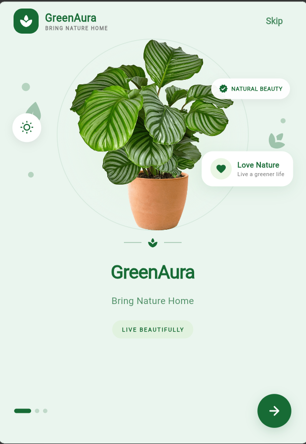
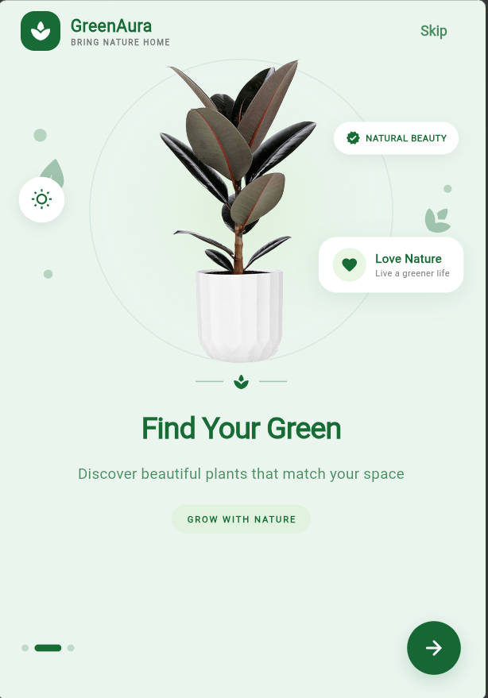
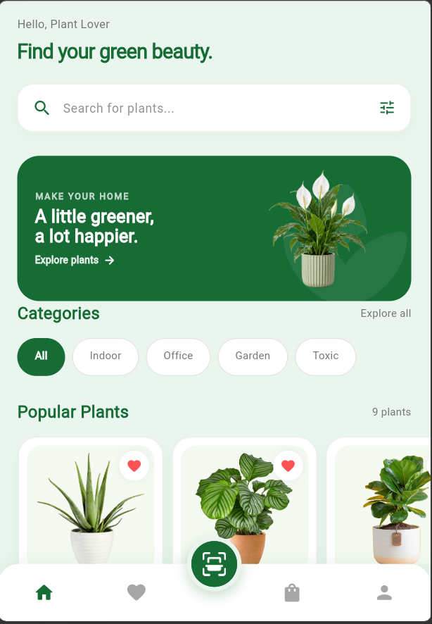
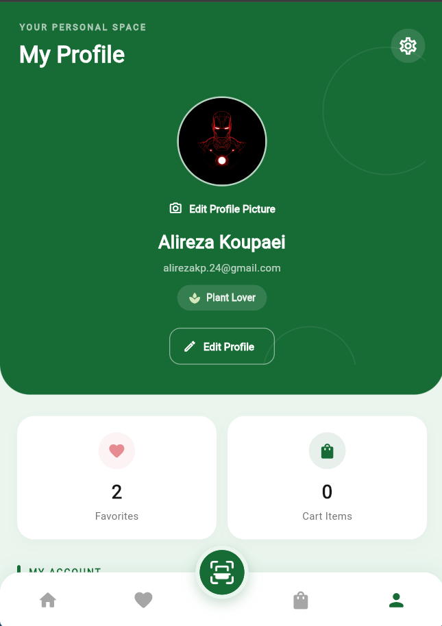

# 🌿 GreenAura – Plant Shopping App

**GreenAura** is a Flutter-based mobile application designed to make discovering and shopping for plants simple, enjoyable, and accessible.

With a clean, nature-inspired interface, users can explore different plants, browse categories, view detailed product information, save their favorite plants, and manage their shopping cart.

The Flutter frontend is complete and currently uses simulated data. A **FastAPI backend** is being developed as the next stage of the project.

## ✨ Features

- **Onboarding:** Introduction to the GreenAura application.
- **Home Page:** Browse plants, explore categories, and search for products.
- **Plant Details:** View plant descriptions, prices, ratings, sizes, humidity, and temperature information.
- **Favorites:** Add plants to or remove plants from your favorites.
- **Shopping Cart:** Add and remove products, update quantities, and calculate subtotals and totals.
- **Profile:** View and edit basic profile information.
- **Plant Scanner UI:** Select plant images using the camera or gallery.
- **Navigation:** Navigate between application sections using a custom bottom navigation bar.

## 📱 Application Screenshots

### Onboarding

| Splash Screen 1 | Splash Screen 2 | Splash Screen 3 |
|:---:|:---:|:---:|
|  |  |  |

### Main Application

| Home Page | Plant Details |
|:---:|:---:|
|  |  |

| Favorites | Shopping Cart |
|:---:|:---:|
|  |  |

| Profile |
|:---:|
|  |

## 🛠️ Technologies Used

- **Flutter** – Cross-platform mobile application development.
- **Dart** – Programming language.
- **Material Design** – User interface components.
- **Image Picker** – Camera and gallery image selection.
- **Animated Bottom Navigation Bar** – Navigation experience.
- **Page Transition** – Screen transition animations.

## 📂 Project Structure

```text
lib/
├── const/
│   └── constant.dart
│
