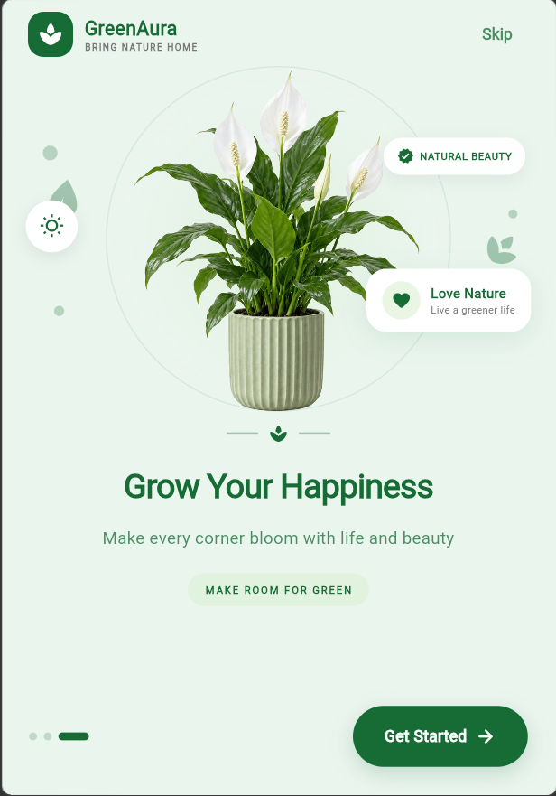
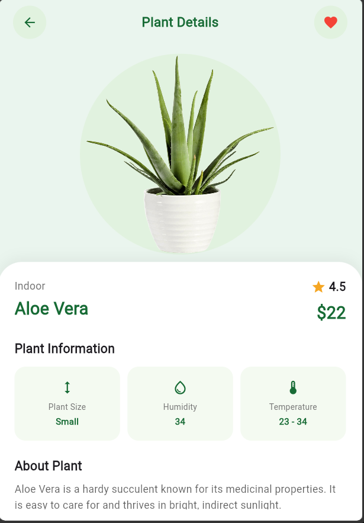
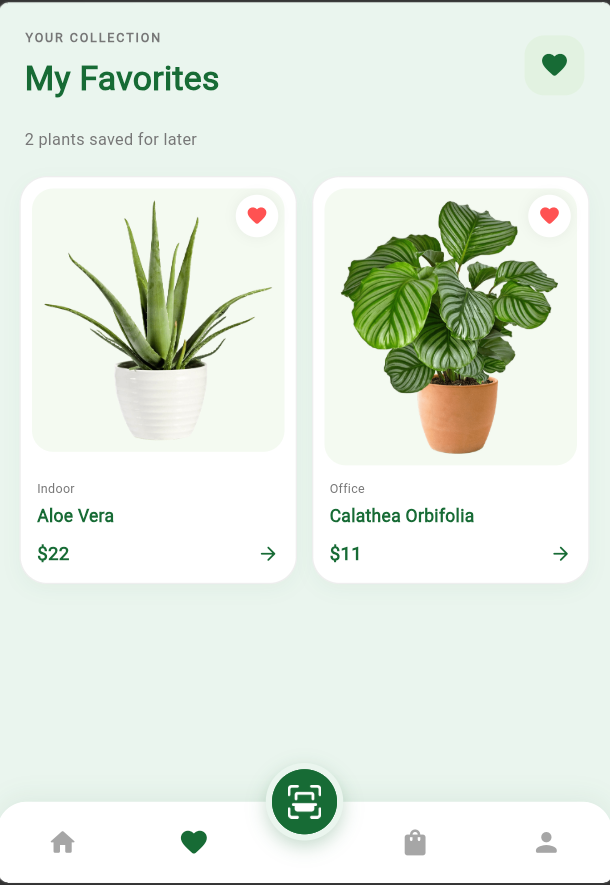
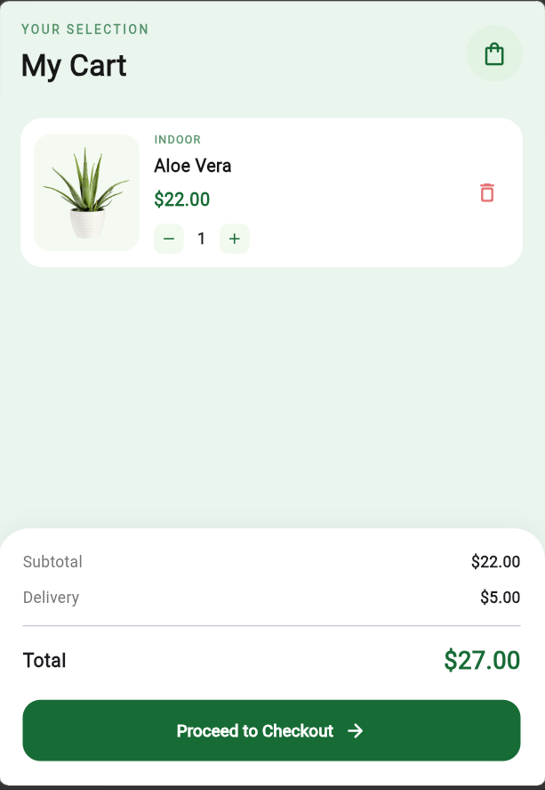

# 🌿 GreenAura — Plant Shopping App

GreenAura is a Flutter-based plant shopping application connected to a FastAPI backend. It provides a clean, nature-inspired shopping experience where users can discover plants, explore categories, view product details, manage favorites, and personalize their profiles.

## ✨ Features

- **Plant Catalogue:** Browse plants retrieved from the FastAPI backend.
- **Search & Categories:** Search for plants and filter them by category.
- **Plant Details:** View descriptions, prices, ratings, sizes, humidity, and temperature information.
- **Authentication:** Register, log in, and maintain an authenticated session.
- **Favorites:** Save and remove favorite plants with user-specific backend persistence.
- **User Profile:** View and update account information.
- **Profile Pictures:** Upload profile pictures from the gallery.
- **Shopping Cart:** Add plants, manage quantities, and calculate totals.
- **Plant Scanner UI:** Select plant images using the gallery or camera.

## 📱 Screenshots

### Onboarding

| Welcome | Discover | Get Started |
|:---:|:---:|:---:|
|  |  |  |

### Main Application

| Home | Plant Details |
|:---:|:---:|
|  |  |

| Favorites | Shopping Cart |
|:---:|:---:|
|  |  |


## 🛠️ Technologies Used

- Flutter
- Dart
- FastAPI
- REST API
- HTTP
- Shared Preferences
- Image Picker
- Material Design
- SQLite (backend database)

## 🔗 Related Repository

The backend is maintained separately:

[GreenAura Plant Shop API](https://github.com/ARK13-org/Greenaura-Plant-Shop-Api)

## 🚀 Getting Started

### Prerequisites

- Flutter SDK
- Dart SDK
- Visual Studio Code or Android Studio
- GreenAura FastAPI backend

### Installation

1. Clone the repository:

```bash
git clone https://github.com/ARK13-org/Greenaura-Plant-Shop.git
```

2. Navigate to the project directory:

```bash
cd Greenaura-Plant-Shop
```

3. Install dependencies:

```bash
flutter pub get
```

4. Start the FastAPI backend by following its README instructions.

5. Run the Flutter application in Chrome:

```bash
flutter run -d chrome --web-port 2350
```

The default API address is `http://127.0.0.1:8000`.

## 📌 Project Status

The Flutter application and FastAPI integration are implemented and tested.

### Current Scope

- Plant catalogue and category management through the API.
- User registration and authentication.
- Profile management and profile-picture uploads.
- Persistent, user-specific favorites.
- Local shopping cart functionality.

### Current Limitations

- Shopping cart checkout and payment processing are not implemented.
- Automatic plant identification is not implemented; the scanner currently supports image selection.
- The application is configured for local backend development and has not been deployed.

## 👨‍💻 Developer

Developed as a portfolio project to demonstrate Flutter application development, REST API integration, backend communication, and full-stack application development.

---

**GreenAura — Bring Nature Home 🌱**
